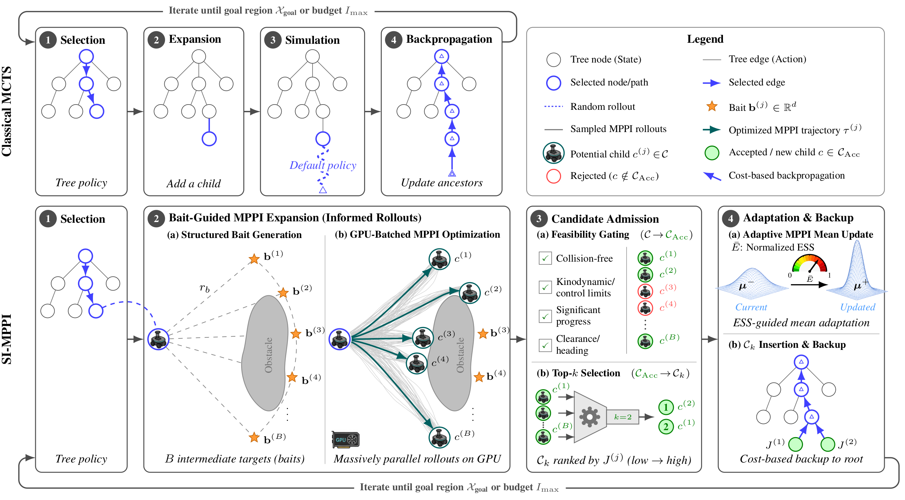

# SI-MPPI: Search-Informed MPPI for Kinodynamic Motion Planning via Monte Carlo Tree Expansion

**Ihab S. Mohamed and Lantao Liu**

Luddy School of Informatics, Computing, and Engineering, Indiana University Bloomington

[**Project Page**](https://ihabmohamed.github.io/SI-MPPI/) | [**Benchmark Videos**](https://ihabmohamed.github.io/SI-MPPI/#benchmarks) | **Paper** (coming soon) | **Code** (coming soon)



## Overview

SI-MPPI is a kinodynamic motion planning framework that integrates Monte Carlo Tree Search (MCTS) with GPU-batched Model Predictive Path Integral (MPPI) trajectory optimization. It replaces the conventional expansion and default-policy simulation stages of MCTS with a unified bait-guided MPPI expansion, while retaining Upper Confidence Bound (UCB)-based selection and cost-based backpropagation. MCTS explores competing long-horizon routes, while MPPI generates cost-informed, dynamically feasible motion segments that, once admitted, form the edges of the search tree.

Each planning iteration comprises four stages:

1. **Selection:** A UCB-based tree policy traverses the search tree to select an unexpanded node.
2. **Bait-guided MPPI expansion:** Baits distributed along a forward-oriented arc around the selected node serve as local targets for GPU-batched MPPI optimization, which generates candidate motion segments in parallel.
3. **Candidate admission:** Feasibility gating checks candidates for collision safety and sufficient progress, while top-$k$ selection adds at most $k_b$ of the lowest-cost accepted candidates to the tree.
4. **Adaptation and backup:** Effective sample size (ESS)-guided adaptation provides warm starts for subsequent expansions, while cost-based backpropagation updates tree statistics.

## Results at a Glance

Across four 100 m × 100 m occupancy-grid maps (Rand, Cave, 4Moons, and MGate), SI-MPPI is evaluated against kinodynamic MCTS, LQR-RRT*, and Informed Kinodynamic RRT* (IK-RRT*). The results are aggregated from five trials per map, with equal weight assigned to each map.

- **15.4×** smaller average search trees than kinodynamic MCTS (521 vs. 8,033 nodes).
- **21.8%** shorter average paths than kinodynamic MCTS (138.90 vs. 177.57 m).
- **26.8× / 9.7×** lower average planning time than LQR-RRT* / IK-RRT* (8.38 s on average).
- **4.8–37×** lower RMS angular acceleration than the baselines across all four maps.

The [project page](https://ihabmohamed.github.io/SI-MPPI/) presents side-by-side planner comparisons on each map, together with a single-branch retention ablation and additional runs, including failure cases.

## Repository Status

- [x] Project webpage and benchmark videos prepared for GitHub Pages
- [ ] SI-MPPI source code and experiment configurations (coming soon)
- [ ] Paper link (coming soon)

Watch this repository for updates on the code release.

## Citation

If you find SI-MPPI useful in your research, please cite:

```bibtex
@misc{mohamed2026simppi,
  title  = {Search-Informed {MPPI} for Kinodynamic Motion Planning via {Monte Carlo} Tree Expansion},
  author = {Mohamed, Ihab S. and Liu, Lantao},
  year   = {2026},
  note   = {Under review}
}
```

*Citation information will be updated when the paper becomes publicly available.*

## Contact

For questions or feedback, please open a GitHub issue or contact **Ihab S. Mohamed** at [mohamedi@iu.edu](mailto:mohamedi@iu.edu).
